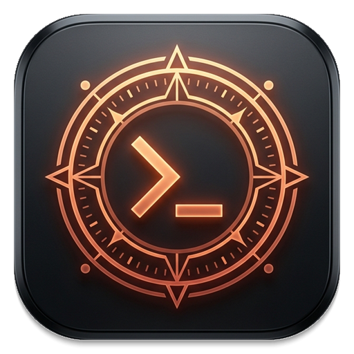
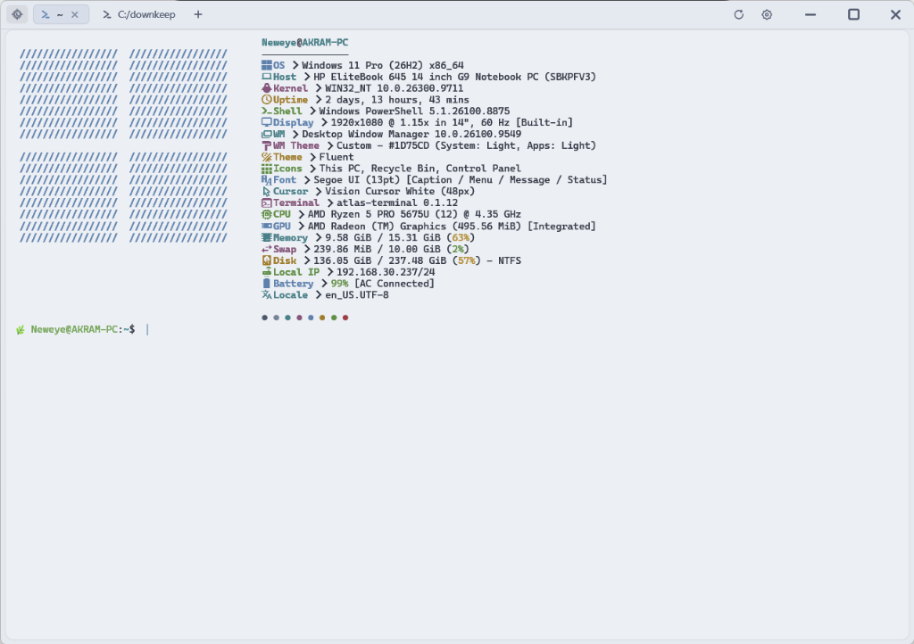
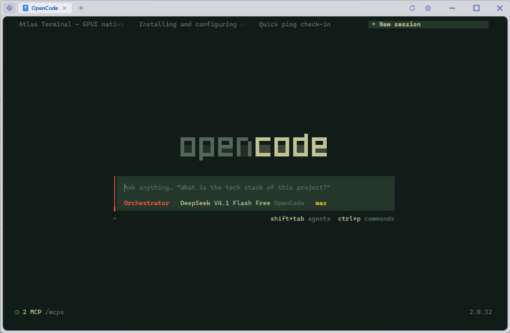

<p align="center">
  
</p>

<h1 align="center">Atlas Native</h1>

<p align="center">
  <strong>The high-performance GPU terminal engine powering Atlas Terminal on Windows.</strong>
</p>
<p align="center">
  <em>DirectX via GPUI · 240Hz Adaptive Motion · Zero Webview / Electron · SGR Mouse Reporting · iTerm2 Inline Images</em>
</p>

<p align="center">
  
  
<p align="center">
  
  <a href="https://github.com/akrram0"></a>
</p>

> **Note:** This project was built by AI and tested & reviewed by [@akrram0](https://github.com/akrram0).

---

## Technical Stack

| Layer | Crate | Details |
|---|---|---|
| **Window + UI + GPU Engine** | `gpui 0.2.2` | Zed's UI framework on Windows: DirectX / DirectComposition + DirectWrite |
| **Terminal Emulation** | `alacritty_terminal 0.26` | Alacritty's VTE parser, cell grid, scrollback history, SGR mouse reporting |
| **Inline Graphics Engine** | `image_osc` | Stateful OSC 1337 scanner, base64 decoder, and BGRA `gpui::RenderImage` textures |
| **PTY Layer** | `portable-pty 0.8` | Windows ConPTY architecture |
| **Async Plumbing** | `smol 2` | Channel synchronization between ConPTY reader thread & GPUI UI thread |
| **Iconography** | Vector SVGs (`crate::icons`) | Zero Unicode icons; Solar Linear stroked SVGs loaded via `IconsAssets` |
| **Timer Precision** | Windows Multimedia Timer | `timeBeginPeriod(1)` yielding 1ms scheduler resolution for up to 240Hz refresh |

---

## Engine Capabilities

### ⚡ 240Hz Adaptive Motion Loop
- Real-time adaptive frame scheduling in `view.rs`:
  - **4ms (~240Hz)** during active scrolling, cursor gliding, tab collapsing, or theme crossfading.
  - **16ms (~60Hz)** for organic cursor breathing.
  - **33ms (~30Hz)** when quiescent (0% idle CPU).
- Calibrated critically damped kinetic scroll decay (`-18.0 * dt`) with flick velocity boost.
- Continuous ceil-aligned subpixel row rendering (`(pos - pos.ceil()) * cell_height`) eliminating row jumps.

### 🖼️ Inline Graphics (iTerm2 OSC 1337 Protocol)
- **Pre-Parser Stateful Interceptor**: Scans incoming PTY chunks across 8KB boundaries before Alacritty's VTE parser sees them.
- **Chronological Event Streaming**: Emits clean byte runs and decoded image anchors in exact sequence so pre-image escape codes (clears, cursor jumps) take effect before an image is placed.
- **GPU BGRA Render Pass**: Decodes base64 PNG/JPEG/WebP/GIF into `gpui::RenderImage` textures, painted on DirectX directly between background cell quads and shaped glyph runs.
- **Natural Vertical Flow**: Advances cursor by `rows` newlines and anchors to absolute history lines so images scroll naturally with terminal history and prune cleanly at the 10,000-line boundary.

### 🖱️ SGR Mouse Reporting & TUI Interactivity
- Encodes SGR 1006 mouse events directly to the active PTY:
  - Down: `\x1b[<{btn};{col};{row}M`
  - Up: `\x1b[<{btn};{col};{row}m`
  - Drag / Motion: `\x1b[<{btn + 32};{col};{row}M`
  - Wheel: `\x1b[<64;{col};{row}M` / `\x1b[<65;{col};{row}M`
- TUI apps (**OpenCode**, **Lazygit**, **Micro**, **Helix**) are fully clickable and interactive.
- Native text drag-selection and copy-on-select when holding `Shift` or in standard shell mode.

### 🔗 Clickable Links & URL Scanner
- Scans visible lines and soft-wrapped `Flags::WRAPLINE` terminal rows for hyperlinks (`http://`, `https://`, `file://`, `www.`, `git://`, `ssh://`, `ftp://`, `mailto:`).
- `Ctrl + Hover`: Real-time highlight with accent color and underline, plus pointer hand cursor.
- `Ctrl + Click`: Dispatches to `ShellExecuteW` directly to default browser without disturbing terminal selection or sending clicks to child processes.
- Keyboard Link Picker: `Ctrl+Shift+O` opens detected links directly from keyboard or surfaces them in the Command Palette.

### ⌨️ Mouseless Navigation & Supercharged Command Palette
- **Full Keyboard Navigation**: Switch tabs directly with `Ctrl+1..9`, cycle with `Ctrl+Tab`/`Ctrl+Shift+Tab`/`Ctrl+PageUp`/`Ctrl+PageDown`/`Ctrl+Shift+[`/`]`.
- **Pane Navigation**: Focus adjacent split panes with `Alt+Arrows` or `Ctrl+Alt+Arrows`.
- **Kinetic Scrolling**: Fast 15-line navigation (`Shift+PageUp`/`Shift+PageDown`), 1-line fine tuning (`Ctrl+Shift+Up`/`Ctrl+Shift+Down`), or buffer jump (`Shift+Home`/`Shift+End`).
- **Multi-Word Command Palette**: Search across labels and shortcuts, spawn profiles (PowerShell, WSL, Cmd, Git Bash, OpenCode), and execute buffer links with ease.

### 🪟 Windows 11 DWM Integration & Smooth 10px Corners
- Frameless `titlebar: None` client area subclassed via Win32 `wndproc` for native DWM rounding.
- Edge-to-edge terminal canvas with smooth 10px inner rounded corners matching the active terminal/TUI background.

### 🔄 In-App Streaming Background Updater
- Built-in GitHub Releases query, streaming chunked download, and RFC 6234 SHA-256 verification.
- Silent restart using Inno Setup command-line flags.

---

## Architecture & Layout

```
atlas-native/
├── Cargo.toml
└── src/
    ├── main.rs            # Process setup, 1ms timer, Win32 DWM corner rounding
    ├── view.rs            # AtlasView: chrome, 240Hz ticker, tabs, command palette
    ├── session.rs         # Session: ConPTY + alacritty Term + background reader
    ├── url.rs             # Hyperlink detection, wrap-line scanner, and browser dispatcher
    ├── image_osc.rs       # iTerm2 OSC 1337 streaming scanner, base64 decode, grid sizing
    ├── updater.rs         # In-app background streaming installer & SHA-256 verification
    ├── keymap.rs          # Keystroke mapping & SGR mouse sequence generation
    ├── theme.rs           # Dual-theme palette definitions & color interpolation
    ├── cwd.rs             # Live working directory resolution (PEB read)
    ├── icons.rs           # Embedded Solar Linear vector icons (AssetSource)
    ├── terminal/
    │   ├── element.rs     # GPU grid renderer, link highlighting, and image textures
    │   └── procedural.rs  # Pixel-perfect block elements and box drawing
    └── ui/
        ├── controls.rs    # Tactile steppers, toggle pills, and option buttons
        ├── settings.rs    # Settings page with smart dynamic contrast
        ├── palette.rs     # Command palette (Ctrl+K / Ctrl+Shift+P)
        ├── overlay.rs     # Modal sheets and contextual menus
        └── animation.rs   # CubicBezier easing curves & motion physics
```

---

## Build & Development

Atlas Terminal builds via GitHub Actions on `windows-latest`. To run locally:

```powershell
cd atlas-native
cargo run --release
```

*(Note: On Windows, release compilation locates `fxc.exe` from the Windows SDK automatically).*
